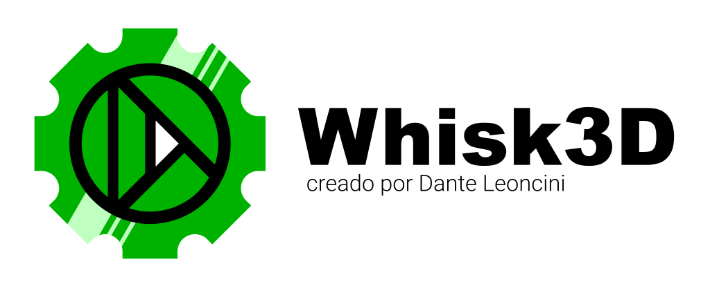

# Whisk 3D

    

    
    

## Motor multiplataforma 2D y 3D estilo retro

Whisk3D es una herramienta de creación 2D/3D estilo retro, con el objetivo de llevar el modelado, render, animación y desarrollo de videojuegos a cualquier dispositivo, incluso aquellos “Obsoletos”.

Nació como un clon liviano de Blender para Nokia, pero hoy es mucho más: un entorno creativo, centrado en la estética low-poly y la identidad visual de PlayStation, Dreamcast y la PC retro. Whisk3D prioriza la velocidad, la accesibilidad y la diversión por encima de la complejidad excesiva.

## ¡Software Libre!

La licencia MIT permite que cualquiera pueda usarlo libremente para crear juegos, proyectos comerciales, educativos o artísticos, e incluso hacer forks y expandir la herramienta sin restricciones.

**Aun esta en pre-alpha**, una primera mirada a algo que todavía está creciendo, pero con una visión clara: que cualquier persona pueda modelar, animar, diseñar, renderizar y desarrollar juegos 3D sin necesitar una PC moderna ni enfrentar curvas de aprendizaje intimidantes.
Whisk3D se construye con una filosofía sencilla: **el hardware no debería morir por el software**. Busco demostrar que la obsolescencia programada puede revertirse desde el código, que una máquina considerada “vieja” puede seguir creando, imaginando y generando contenido nuevo.

El proyecto, y los videojuegos que se desarrollen con él, planean sostenerse mediante donaciones voluntarias, **no con microtransacciones, publicidad molesta, loot boxes, ni mecanismos diseñados para generar adicción o manipular al jugador.**
Whisk3D **NO** instala servicios ocultos, no espía al usuario ni vende sus datos, no exige cuentas ni conexión permanente. **Respetamos a los creadores y jugadores**.

Queremos **devolverte el control de tu software**, democratizar la creación y permitirle a las nuevas generaciones experimentar con el 3D **sin barreras técnicas ni económicas**.

## Videos

| | |
|:---:|:---:|
|  Demo de Crash Bandicoot 3 |  Demo de Dragon Ball Z: Budokai Tenkaichi 3 |
|  Demo de Half-Life 2 |  Demo de Resident Evil 4 |

El video original, en el Nokia N95: [Blender for Nokia N95](https://youtu.be/dMe-Vit5OT0). Más en el [canal de YouTube](https://www.youtube.com/DanteLeoncini).

## Funciones

- **Modelado:** Modo Objeto y Modo Edición (vértices, aristas y caras). Mover, rotar y escalar con el gizmo o con atajos, selección por caja, loop cut, edición proporcional, snap y X-Ray.
- **Modificadores:** Mirror, Array, Screw, Subdivision Surface, Boolean, Armature y Oclusión.
- **Esqueletos y animación:** huesos, Pose Mode y deformación de mallas, línea de tiempo con keyframes y auto key, animación de vértices y motion trail.
- **Pintura:** vertex paint, weight paint y texture paint.
- **Materiales y texturas:** capas de texturas, normal maps, mezcla de dos texturas, matcap y contorno estilo dibujo animado. Editor UV.
- **Render:** vistas sólida, material, render, alambre, Z-Buffer y normales, y trazado de rayos en el viewport.
- **Videojuegos:** scripts en Lua con un editor integrado (IDE), física (cuerpos rígidos y hitboxes), partículas, LOD, oclusión, streaming de mundos abiertos, interfaz 2D con su propio editor y sonido. El juego se compila desde el editor para Linux (.deb y AppImage), Android y la web (WebGL).
- **Archivos:** importa OBJ, FBX, glTF y GLB; exporta OBJ y glTF. Los proyectos se guardan en `.w3d`, un formato abierto (ver más abajo).

El [manual del editor](https://leoncini.com.ar/manual.php?id=editor&lang=es) y el [manual de Lua](https://leoncini.com.ar/manual.php?id=lua&lang=es) explican cada una en detalle.

## Requisitos mínimos

El piso de referencia es el **Nokia N95** (2007): un CPU ARM11 de 332 MHz, 64 MB de RAM (128 MB en el N95 8GB) y una GPU PowerVR MBX con OpenGL ES 1.1. Si corre ahí, corre en casi cualquier cosa.

| Sistema | Qué hace falta |
|---|---|
| Windows, GNU/Linux, macOS | Una placa de video con OpenGL 1.x (usa el pipeline fijo; si hay OpenGL 1.5, aprovecha los VBO) |
| Android | Android 2.3 (API 10) o más nuevo: desde el 5.0, el APK de siempre; de 2.3 a 4.4, un APK aparte para ARMv6 y OpenGL ES 2.0 (probado en un Samsung Galaxy Ace de 2011, con un ARM11 de 832 MHz) |
| Web | Un navegador con WebGL |
| Symbian (s60v3, s60v5, Symbian^3) | OpenGL ES 1.1 (por ejemplo un Nokia N95 o N8) |
| Sega Dreamcast | Mouse y teclado de Dreamcast o el control. **Experimental** |
| Nintendo 3DS | El Homebrew Launcher (cualquier modelo: la vieja tiene un CPU de 268 MHz). **Experimental**: probado en el emulador, en la consola real todavía hay errores |

## El formato `.w3d`

Un proyecto `.w3d` es un juego entero en un solo archivo, abierto y legible, con la misma idea que un `.odt` de OpenDocument:

- Es un **ZIP común**, con las escenas, los scripts, las texturas, los sonidos y los modelos en carpetas.
- La escena va en **`proyecto.json`**, legible y editable a mano. Los scripts son texto Lua y los modelos usan glTF/GLB. Para cargar rápido, las mallas y las animaciones tienen además formatos binarios propios (`.w3db` y `.w3da`), todavía experimentales.
- Al ser abierto, un juego **se puede preservar, modificar y vender sin DRM**, y para llevarlo a otro sistema alcanza con portar el reproductor, no cada juego.

Más detalle en el artículo [W3D: un formato abierto para que los videojuegos no mueran](https://leoncini.com.ar/articulo.php?id=w3d-formato-abierto&lang=es).

## ¿Por qué en un Nokia N95?

Para demostrar que modelar, animar y renderizar en 3D no necesita una computadora cara. El N95 tiene un ARM11 de 332 MHz con FPU por hardware y una GPU PowerVR MBX con aceleración 3D que dibuja millones de triángulos por segundo, del mismo orden que la SGI RealityEngine² de 1993 que se usó para efectos como los de Jurassic Park. No es basura: es hardware desperdiciado. El proyecto quiere generar conciencia contra la obsolescencia programada y a favor de teléfonos más baratos, reparables y duraderos.

La historia completa está en [Whisk3D: ¿por qué hacerlo en un Nokia N95?](https://leoncini.com.ar/articulo.php?id=whisk3d-en-nokia-porque&lang=es).

## Compilar e instalar

Whisk3D corre en Linux, Windows, Mac, Android, Symbian y Web, y de forma experimental en Sega Dreamcast y Nintendo 3DS. Las instrucciones de cada sistema están en:

- [Windows](platform/windows/README.md) · [GNU/Linux](platform/linux/README.md) · [macOS](platform/mac/README.md)
- [Web (WebGL)](platform/web/README.md) · [Android](platform/android/README.md) · [Android 2.3 a 4.4](platform/android-viejo/README.md) · [Symbian s60v3/s60v5/Symbian^3 (N95/N8)](platform/symbian/README.md)
- [Sega Dreamcast](platform/dreamcast/README.md) · [Nintendo 3DS](platform/3ds/README.md)

En todos, primero: `git submodule update --init --recursive` (los scripts `platform/<sistema>/build_*` ya lo hacen por vos).

## MCP: Whisk3D para IAs

Whisk3D fue hecho para personas, pero el avance de la IA es innegable. Así que se agregó un MCP para que puedan usarlo.

El **MCP** (Model Context Protocol) es un estándar abierto para que una IA, como Claude, use programas. Con `whisk3d --mcp`, el editor abre como siempre y además atiende a la IA: lo que hace se ve en la ventana y se deshace con Ctrl+Z. Solo está en la versión de PC.

Las herramientas y cómo configurarlo, en [docs/mcp.md](docs/mcp.md).

## Aclaraciones:

1. No es un port: Este programa **no comparte** código con Blender.
2. Obsolescencia programada: El objetivo del proyecto **es evidenciar la obsolescencia programada** de los teléfonos, antiguos como actuales. Busco generar una demanda por parte de los consumidores de teléfonos más sostenibles y duraderos, reduciendo la enorme cantidad de residuos electrónicos. también ayudaría a que mas gente acceda a la tecnología gracias al reciclaje de estos antiguos dispositivos.
3. Conocimiento en informática: Queremos resaltar la falta de conocimiento general en informática. No debería sorprender que Whisk 3D funcione en un Nokia N95, un teléfono que en su tiempo era de gama alta, comparable con un iPhone 17 Pro Max de hoy. Quiero dejar claro que con 300 MHz y 128 MB de RAM se pueden realizar tareas que hoy en día requieren teléfonos con 8 GB de RAM y procesadores multicore.

## ¡Gracias!

Gracias a todos los que compartieron el proyecto. y a la gente que esta empezando a contribuir con el codigo
Gracias a Marcig por el nuevo nombre!

# ¡Participa!

Tengo pensado agregar mas funciones. 
Cualquier aporte que quiera realizar al código es Bienvenida.

    
    

